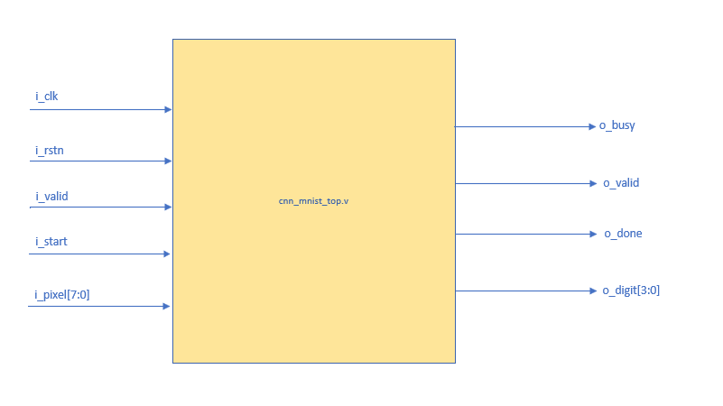
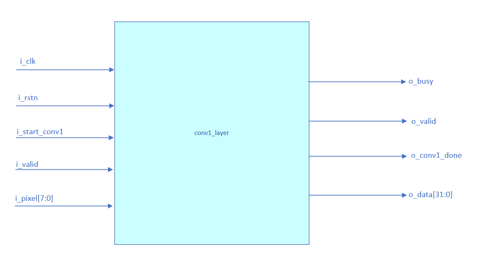
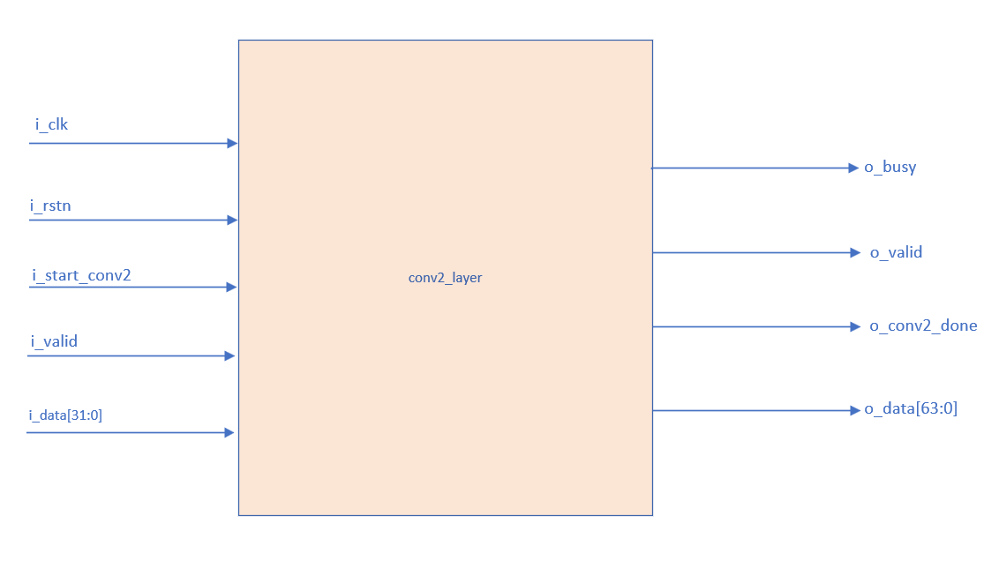

# CNN MNIST Q4.4 — RTL Accelerator

Bit-exact Verilog/SystemVerilog reference implementation of a small MNIST CNN using signed INT8 Q4.4 fixed-point arithmetic.

> **Phase 1 goal:** Build a correct, bit-exact RTL reference against the Python golden model.  
> PPA optimization, MAC reuse, BRAM mapping, AXI integration, and accelerator-level optimization come later.

## Block Diagrams

The diagrams are organized into **module interfaces** (external ports and data widths) and **internal architecture** (processing stages and dataflow). Interface diagrams describe the intended module boundaries; they do **not** imply that the corresponding RTL modules have already passed verification.

### Module Interfaces

#### CNN Top-Level Interface — `cnn_mnist_top.v`

<p align="center">
  
</p>

The CNN top level accepts an 8-bit pixel stream and coordinates inference across the network.

| Direction | Port | Width | Description |
|---|---|---:|---|
| Input | `i_clk` | 1 | System clock |
| Input | `i_rstn` | 1 | Active-low reset |
| Input | `i_valid` | 1 | Input pixel valid |
| Input | `i_start` | 1 | Start inference |
| Input | `i_pixel` | 8 | Signed INT8 Q4.4 input pixel |
| Output | `o_busy` | 1 | Inference busy status |
| Output | `o_valid` | 1 | Prediction valid |
| Output | `o_done` | 1 | Inference completion |
| Output | `o_digit` | 4 | Predicted MNIST class (0–9) |

#### Conv1 Layer Interface — `conv1_layer.v`

<p align="center">
  
</p>

Conv1 receives a single-channel 28×28 pixel stream and ultimately emits 32-bit words. The four byte lanes of the output are governed by the layer's agreed data-ordering contract.

| Direction | Port | Width | Description |
|---|---|---:|---|
| Input | `i_clk` | 1 | System clock |
| Input | `i_rstn` | 1 | Active-low reset |
| Input | `i_start_conv1` | 1 | Start Conv1 processing |
| Input | `i_valid` | 1 | Input pixel valid |
| Input | `i_pixel` | 8 | Signed INT8 Q4.4 input pixel |
| Output | `o_busy` | 1 | Conv1 busy status |
| Output | `o_valid` | 1 | Output word valid |
| Output | `o_conv1_done` | 1 | Conv1 completion |
| Output | `o_data` | 32 | Packed output data for the next stage |

#### Conv2 Layer Interface — `conv2_layer.v`

<p align="center">
  
</p>

Conv2 receives 32-bit words from the Conv1/Feature Mem1 path and produces 64-bit output words for the downstream memory path. The input words follow the canonical flattened feature-memory ordering, **not** necessarily four channels at one spatial coordinate.

| Direction | Port | Width | Description |
|---|---|---:|---|
| Input | `i_clk` | 1 | System clock |
| Input | `i_rstn` | 1 | Active-low reset |
| Input | `i_start_conv2` | 1 | Start Conv2 processing |
| Input | `i_valid` | 1 | Input word valid |
| Input | `i_data` | 32 | Packed input feature data |
| Output | `o_busy` | 1 | Conv2 busy status |
| Output | `o_valid` | 1 | Output word valid |
| Output | `o_conv2_done` | 1 | Conv2 completion |
| Output | `o_data` | 64 | Packed output data for the next stage |

> **Naming note:** The interface figures use `i_rstn`, while the existing verified leaf modules use `i_rst_n`. Preserve the actual RTL port names when instantiating modules; the diagrams do not define an automatic alias. Completion/busy timing must be specified and verified when each layer is implemented.

### Internal RTL Architecture

#### CNN Processing Architecture

<p align="center">
  
</p>

The intended top-level flow is controlled by `top_fsm`:

```text
Input stream
    ↓
Conv1 layer
    ↓
Feature Mem1
    ↓
Conv2 layer
    ↓
Feature Mem2
    ↓
Fully Connected
    ↓
ArgMax
    ↓
digit[3:0]
```

#### Conv1 Datapath

<p align="center">
  
</p>

```text
conv1_buf → conv1_calc → conv1_quant_relu → pool1_buf → pool1
          → pool1_reorder → feature_mem1
```

#### Conv2 Datapath

<p align="center">
  
</p>

```text
feature_mem1 → conv2_buf → conv2_calc → conv2_quant_relu
             → pool2_buf → pool2 → pool2_reorder → feature_mem2
```

## Network

| Stage | Shape | Format |
|---|---:|---|
| Input | `1×28×28` | INT8 Q4.4 |
| Conv1 | `4×26×26` | INT32 Q8.8 raw accumulator |
| ReLU1 | `4×26×26` | INT8 Q4.4 |
| Pool1 | `4×13×13` | INT8 Q4.4 |
| Conv2 | `8×11×11` | INT32 Q8.8 raw accumulator |
| ReLU2 | `8×11×11` | INT8 Q4.4 |
| Pool2 | `8×5×5` | INT8 Q4.4 |
| FC | `10 logits` | INT32 Q8.8 |
| Output | `digit[3:0]` | class `0..9` |

## Numerical Contract

| Item | Rule |
|---|---|
| Input / weights / bias / feature maps | signed INT8 Q4.4 |
| Q4.4 scale | `16` |
| Product | signed Q8.8 |
| Conv / FC accumulator | signed INT32 Q8.8 |
| Bias alignment | `bias << 4` |
| Requantization | round-to-nearest-even, then saturate to `[-128,127]` |
| Activation | ReLU after requantization |
| FC output | raw signed INT32 Q8.8 |
| ArgMax tie rule | strict `>`; lowest index wins |

`python/golden_model.py` is the numerical source of truth. RTL arithmetic operates on signed integer bit patterns; Q4.4/Q8.8 specify their implicit fixed-point scales.

## Repository Structure

```text
cnn-mnist-q44/
├── rtl/
│   ├── common/
│   │   ├── round_shift_even.v
│   │   ├── sat_int8.v
│   │   └── relu_int8.v
│   ├── memory/
│   │   ├── feature_mem1.v
│   │   └── feature_mem2.v
│   ├── rom/
│   │   ├── conv1_rom.v
│   │   ├── conv2_rom.v
│   │   └── fc_rom.v
│   ├── conv1/
│   │   ├── conv1_buf.v
│   │   ├── conv1_calc.v
│   │   ├── conv1_quant_relu.v
│   │   ├── pool1_buf.v
│   │   ├── pool1.v
│   │   ├── pool1_reorder.v
│   │   └── conv1_layer.v
│   ├── conv2/
│   │   ├── conv2_buf.v
│   │   ├── conv2_calc.v
│   │   ├── conv2_quant_relu.v
│   │   ├── pool2_buf.v
│   │   ├── pool2.v
│   │   ├── pool2_reorder.v
│   │   └── conv2_layer.v
│   ├── fc/
│   │   ├── fully_connected.v
│   │   └── argmax.v
│   ├── control/
│   │   └── top_fsm.v
│   └── top/
│       └── cnn_mnist_top.v
├── python/
│   ├── train_model_python.py
│   ├── golden_model.py
│   ├── export_hex.py
│   └── smoke_test_golden.py
├── tb/
├── data/
├── docs/
│   ├── RTL_SPEC.md
│   ├── VERIFICATION_ROADMAP.md
│   ├── PROJECT_PROGRESS.md
│   └── images/
│       ├── cnn_mnist_top_interface.png
│       ├── conv1_layer_interface.png
│       ├── conv2_layer_interface.png
│       ├── top_level_block_diagram.png
│       ├── conv1_block_diagram.png
│       └── conv2_block_diagram.png
└── README.md
```

> The tree documents the intended repository layout. Not all listed RTL files are implemented or verified yet.

## Python Golden Flow

| File | Purpose |
|---|---|
| `python/train_model_python.py` | Train the MNIST CNN and save the model checkpoint. |
| `python/golden_model.py` | Bit-exact fixed-point reference model for RTL verification. |
| `python/export_hex.py` | Export parameters, input data, and golden checkpoints. |
| `python/smoke_test_golden.py` | Sanity-check golden arithmetic before generating RTL vectors. |

Run from the project root:

```bash
cd python
python -m pip install -r requirements.txt

python smoke_test_golden.py
python train_model_python.py   # only when a model checkpoint is needed
python export_hex.py
```

## Golden Checkpoints

| RTL stage | Golden file | Format |
|---|---|---|
| `conv1_calc` | `golden_conv1.hex` | 2704 × INT32 Q8.8 |
| `conv1_quant_relu` | `golden_relu1.hex` | 2704 × INT8 Q4.4 |
| Pool1 tensor | `golden_pool1.hex` | 676 × INT8 Q4.4 |
| `conv2_calc` | `golden_conv2.hex` | 968 × INT32 Q8.8 |
| `conv2_quant_relu` | `golden_relu2.hex` | 968 × INT8 Q4.4 |
| Pool2 tensor | `golden_pool2.hex` | 200 × INT8 Q4.4 |
| `fully_connected` | `golden.hex` | 10 × INT32 Q8.8 |
| `argmax` | `prediction.hex` | 1 digit |

## Tensor and Memory Ordering

Canonical feature order:

```text
[channel][row][column]
```

Flatten index:

```text
index = c * (H * W) + y * W + x
```

The Conv/Pool datapath naturally emits all channels for one spatial position, while feature memories use channel-major flattened order. `pool1_reorder.v` and `pool2_reorder.v` perform this conversion before data is written to feature memory.

## Verification Strategy

Verification is bottom-up and stops at the first mismatch:

```text
Golden arithmetic
    ↓
Common arithmetic RTL
    ↓
Conv1 buffer / MAC / quant-ReLU / pool
    ↓
Pool1 reorder + Mem1
    ↓
Conv2
    ↓
Pool2 reorder + Mem2
    ↓
FC
    ↓
ArgMax
    ↓
Top-level inference
```

## Current Progress

| Block | Verification | Status |
|---|---|---|
| `round_shift_even.v` | arithmetic edge/tie cases | PASS |
| `sat_int8.v` | saturation boundaries | PASS |
| `relu_int8.v` | signed INT8 vectors | PASS |
| `conv1_buf.v` | 676 windows × 2 frames | PASS |
| `conv1_calc.v` | 2704/2704 raw accumulators | PASS |
| `conv1_quant_relu.v` | 2704/2704 golden outputs | PASS |
| `pool1_buf.v` | 169 windows × 2 frames | PASS |
| `pool1.v` | next module | TODO |
| Conv1 reorder / Mem1 | pending | TODO |
| Conv2 | pending | TODO |
| FC / ArgMax | pending | TODO |
| Top-level | pending | TODO |

Detailed progress is tracked in [`docs/PROJECT_PROGRESS.md`](docs/PROJECT_PROGRESS.md).

## Phase 1 Resource Strategy

The reference design intentionally favors visible parallelism:

| Block | Reference parallel multipliers |
|---|---:|
| Conv1 | 36 |
| Conv2 | 288 |
| FC | 80 |
| **Total** | **404** |

This is not the final optimized FPGA architecture. Later phases will introduce MAC reuse, GEMM/GEMV, BRAM-based storage, shared compute resources, and PPA optimization.

## Roadmap

```text
Phase 1  Bit-exact reference RTL
   ↓
Phase 2  MAC reuse / GEMM-GEMV refactor
   ↓
Phase 3  Datapath + controller separation
   ↓
Phase 4  BRAM / memory architecture
   ↓
Phase 5  Accelerator control + bus integration
   ↓
Phase 6  PPA optimization and FPGA benchmarking
```

See:

- [`docs/RTL_SPEC.md`](docs/RTL_SPEC.md)
- [`docs/VERIFICATION_ROADMAP.md`](docs/VERIFICATION_ROADMAP.md)
- [`docs/PROJECT_PROGRESS.md`](docs/PROJECT_PROGRESS.md)

## License

Add a license before public release.
